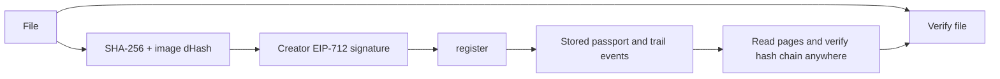

# ProvenanceX

**Portable provenance passports for digital assets on Monad.**
Creators sign a claim about a file hash; later changes can be recorded in a paged, hash-chained trail. A signature records what a wallet claimed, not independent proof of authorship or AI generation.

> Built for **Monad Blitz Pune V3** (10 Oct 2026).

> **Screenshot/GIF:** TODO: add a real product screenshot or demo GIF. Bundled artwork is sample content, not an app screenshot.

---

## Quick links 

| What | Link |
|---|---|
| Live app | Pending deployment |
| Public repo | TODO: verified repository URL |
| Contract (Monad Testnet) | Not deployed; deployment pending |
| Contract source verified | Not verified; pending deployment |
| Contract (Monad Mainnet, bonus) | Not deployed |
| Custom domain (bonus) | TODO: https://... or "none" |
| Demo video (30s+) | TODO: link |
| Ad video | TODO: link |
| Social posts | TODO: X link, LinkedIn link |
| Demo transactions | None; testnet deployment is pending |

**Network:** Monad Testnet, chain ID `10143`, RPC `https://testnet-rpc.monad.xyz`, currency MON, explorer `https://testnet.monadexplorer.com`. Confirm current values at [docs.monad.xyz](https://docs.monad.xyz).

---

## 1. Problem and solution

Digital assets are copied, edited, and reposted without a portable record of their history. ProvenanceX lets a wallet sign a claim for a canonical file hash, then records later events and derivative links in a paged, hash-chained on-chain trail. Anyone can compare an asset with the registry and recompute that trail. An image dHash can suggest visually similar files, but it is a heuristic rather than proof of shared origin. The wallet signature does not independently prove authorship, licensing, legal identity, or AI generation.

## 3. How it works



**Verification outcomes**

| Result | Meaning |
|---|---|
| 🟢 AUTHENTIC | Exact SHA-256 match to a registered, non-revoked passport; the result reflects a signed registration claim, not objective authorship |
| 🟡 MODIFIED / RE-ENCODED COPY | No exact match, but image perceptual distance to a passport is 6 or less; similarity is only a hint |
| 🔴 NO PASSPORT FOUND | No exact or similar match on-chain |
| ⚪ REVOKED | Matching passport was revoked by its creator |

## 4. Smart contract

`contracts/src/ContentPassport.sol` (Solidity ^0.8.24, OpenZeppelin `EIP712` + `ECDSA`).

| Function | Caller | Purpose |
|---|---|---|
| `register(contentHash, perceptualHash, tool, metadataURI, parentId, sig)` | Anyone (signs as themselves) | Creates a passport. First creator of a given hash wins. Verifies the EIP-712 signature. |
| `appendEvent(passportId, eventType, dataHash)` | Creator or authorized operator | Adds an event; `trailHead = keccak256(trailHead, eventType, dataHash, timestamp)` |
| `authorize(passportId, operator, allowed)` | Creator | Grants or removes operator rights |
| `revoke(passportId)` | Creator | Marks the passport revoked |
| `verifyByHash(contentHash)` | View | Returns existence, passport ID, and passport data |
| `getPassport(passportId)` | View | Full passport record |
| `getChildren(passportId)` | View | Derivative passports |
| `totalPassports()` / `getPage(offset, limit)` | View | Paged listing used for perceptual matching without log scans |
| `trailLength(passportId)` / `getTrailPage(passportId, offset, limit)` | View | Paged on-chain audit history, including the initial `REGISTERED` entry |
| `hammingDistance(a, b)` | Pure | Bit distance between two perceptual hashes |

**Events:** `PassportRegistered`, `TrailEvent`, `OperatorSet`, `Revoked`.
**Custom errors:** `AlreadyRegistered`, `ParentNotFound`, `Unauthorized`, `PassportNotFound`, `PassportRevoked`, `ToolTooLong`, `MetadataURITooLong`.

## 5. Features by page

| Route | What it does |
|---|---|
| `/` | Pitch, three-step explainer, live passport counter |
| `/create` | Upload or generate an image, hash it, sign, register, download the passported file and certificate card (QR) |
| `/verify` | Drop any file to get a verification result |
| `/p/[id]` | Public passport page: details, audit trail with client-side hash-chain check, lineage, embeddable badge |
| `/demo` | Guided four-step demo with a live transaction feed |
| `/api/verify?hash=0x...` | JSON endpoint for platform integrations |

## 6. Run it yourself

### Prerequisites

- Node.js 20+
- Forge 1.7.1 is pinned as a local npm binary; OpenZeppelin Contracts 5.4.0 is pinned in the Foundry project.
- A browser wallet (MetaMask or similar)
- Testnet MON from the [Monad Faucet](https://faucet.monad.xyz/) for public-chain writes

> Use a **burner wallet** for testnet. Never use a wallet that holds real funds.

### Step 1: clone and configure

```bash
git clone TODO_REPO_URL provenancex
cd provenancex
cp .env.example .env
```

Install dependencies from the repository root and copy the deployment environment file:

```bash
npm ci --ignore-scripts
npm run install:contracts
cp .env.example contracts/.env
```

Set the private key locally in `contracts/.env`:

```
PRIVATE_KEY=0xYOUR_BURNER_PRIVATE_KEY
CHAIN_ID=10143
```

### Step 2: test the contracts

```bash
npm run build
npm test
npm run coverage
```

### Step 3: deploy to Monad Testnet

```bash
npm exec -- forge script contracts/script/Deploy.s.sol:Deploy \
  --root contracts \
  --rpc-url monad \
  --broadcast
npm run export:deployment
```

The exporter first checks the configured RPC chain ID and then requires a successful deployment receipt and mined block number before updating `web/src/lib/deployment.json` and `web/src/lib/abi.ts`. It defaults to Testnet 10143. Verify the source using Monad's current instructions and add the explorer link to this README only after confirmation. Mainnet chain 143 has a separate export manifest; see below.

### Step 4: run the app

```bash
cd ../web
npm ci
npm run dev
```

Open http://localhost:3000. The canonical manifest is currently unconfigured, so reads and registrations remain pending until a real deployment is exported.

### Step 5: use it

1. With a real Testnet deployment configured, connect a wallet and switch to Monad Testnet (10143) if prompted.
2. Open `/demo` for the guided flow, or `/create` to prepare an asset, sign, and submit a registration.
3. After a successful transaction receipt, download the passport PNG and verify that downloaded file in `/verify`.
4. Change the image and run verification again. Exact identity should no longer match; a dHash candidate may appear for a visually similar image.
5. If the deployment is pending, explore the local hashing flow and bundled samples; do not report a live registration or authenticity result.

### Step 6: deploy the frontend

```bash
cd web
npx vercel --prod
```

Set the same `NEXT_PUBLIC_*` variables in the Vercel project settings.

### Troubleshooting

| Problem | Fix |
|---|---|
| Wallet on the wrong network | Click "Switch to Monad Testnet" in the app header |
| Transaction fails with insufficient funds | Get testnet MON from the faucet |
| `AlreadyRegistered` error | That exact file already has a passport. Use `/verify`, or register a derivative with a parent ID |
| Slow or failing reads | Public RPCs rate-limit. Retry, or set `NEXT_PUBLIC_RPC_URL` in `web/.env.local` |
| Image generation fails | Use the upload option or the bundled samples in `web/public/samples` |

## 7. Demo script (3 minutes)

| Time | Action | Result |
|---|---|---|
| 0:00 | Explain the problem and identify the configured network/address | Landing page |
| 0:20 | If deployed, create/register a sample and wait for its real receipt | Certificate and receipt |
| 1:00 | Verify the downloaded file | Exact registered hash or accurate pending state |
| 1:30 | Change one pixel and explain exact-hash and dHash outcomes | Mismatch or similarity hint; no authorship claim |
| 2:00 | If deployed, append a real event and verify the paged trail | Updated trail and verification result |
| 2:30 | Describe business hypotheses and limitations | No unbuilt services presented as live |

## 8. Decisions and trade-offs

- **Stored paged history instead of log-only `eth_getLogs` scans.** Public RPCs often restrict log ranges; the contract stores each trail entry and exposes `getTrailPage`, so a client can verify the full chain without historical log scans. The cost is additional storage gas per event.
- **First creator wins.** The first registration of a given content hash owns it. This proves *earliest registration*, not legal authorship.
- **Perceptual hash is a heuristic.** dHash can return false similarity and miss transformed copies; it cannot establish common origin. A zero hash is excluded from matching.
- **Hashes, not files, on-chain.** Assets never leave the user's browser unless they choose to host them. Only hashes, a tool tag, and optional metadata URI are stored.
- **Trail integrity is client-verifiable.** The UI recomputes the hash chain from events and compares it to the on-chain `trailHead`.
- **Demo key fallback.** The optional public testnet-only burner key is off by default and must be disposable; it is visible to every visitor.
- **Known limitations:** registration proves a wallet signed the stated claim; it does not prove an asset is "truly AI-made" or that the wallet created it.

## 9. Why Monad

- Monad is the target EVM network, so the project can use standard Solidity and viem/wagmi tooling.
- Finality, throughput, and transaction cost depend on live network conditions; no benchmark or fee guarantee is claimed here.

## 10. Business model

| Stream | Description |
|---|---|
| Per-asset service fee | Proposed managed registration service; current contract has no registration fee |
| Enterprise API | Proposed bulk provenance/verification service; current endpoint is a read-only exact-hash lookup without an SLA |
| Embeddable widget | Proposed platform integration for marketplaces and creative tools |
| Compliance tooling | Possible audit exports; no compliance guarantee is provided |

## 11. Product hypotheses and roadmap

See [docs/pitch.md](docs/pitch.md) for target-customer hypotheses, pilot metrics, and innovation limits. Roadmap: configure and verify the Testnet deployment; run creator and platform workflow pilots; improve integrations based on measured feedback; consider paid services and a separate Mainnet deployment only after validating demand and operating costs.

## 12. Mainnet deployment path

Mainnet is chain 143 and requires a separately funded key and RPC supplied by the deployer. Set `CHAIN_ID=143` and `MAINNET_RPC_URL` in `contracts/.env`, then run `npm exec -- forge script contracts/script/Deploy.s.sol:Deploy --root contracts --rpc-url "$MAINNET_RPC_URL" --broadcast` (PowerShell users can pass `$env:MAINNET_RPC_URL`). Export with `CHAIN_ID=143 MAINNET_RPC_URL=... npm run export:deployment` (set those variables in the shell using its normal syntax). The exporter writes `web/src/lib/deployment.mainnet.json` and leaves the Testnet manifest intact. The UI remains configured for Testnet. Verify the actual source and record the explorer URL after deployment; no Mainnet deployment is claimed.

## 13. Team and license

TODO: add confirmed team names and roles before submission. The project is MIT licensed; see [LICENSE](LICENSE).

## 11. Roadmap

- [ ] Passkey signing via Monad P256 precompile
- [ ] Signed attestations from AI tools and C2PA manifest import/export
- [ ] Video and audio perceptual hashing
- [ ] Browser extension that shows passport badges on any website
- [ ] Mainnet launch and fee module
- [ ] Indexer and public API with caching

## 12. Repository layout

```
.
├── contracts/            Foundry project
│   ├── src/ContentPassport.sol
│   ├── test/ContentPassport.t.sol
│   └── script/Deploy.s.sol
├── web/                  Next.js 14 app (TypeScript, Tailwind, wagmi + viem)
│   ├── src/app/          Pages and API routes
│   └── src/lib/          hash, phash, pngMeta, eip712, trail, registry
├── docs/                 submission, posts, demo checklist
├── .env.example
└── README.md
```

## 13. Tech stack

Solidity 0.8.x, Foundry, OpenZeppelin, Monad Testnet, Next.js 14, TypeScript, Tailwind CSS, wagmi, viem, Web Crypto API, Vercel.

## 14. Team

| Name | Role | Links |
|---|---|---|
| TODO | Smart contracts | TODO |
| TODO | Frontend | TODO |
| TODO | Product, content, docs | TODO |

## 15. Hackathon checklist (for judges)

- [X] Public GitHub repo (URL pending verification)
- [ ] README with live URL and contract address (pending deployment)
- [ ] Contracts deployed on Monad Testnet (pending; deployment.json is null)
- [ ] Project publicly hosted (pending)
- [ ] Contract source verified on explorer (TODO: link)
- [ ] Runnable from this README without help
- [ ] Posts tagging @monad, @monad_dev, @geeky_kartikey
- [ ] Demo video and creative ad video posted
- [ ] Mainnet deployment (bonus)
- [ ] Custom domain (bonus)

> Update the checkboxes honestly before the 5:45 PM IST submission deadline.

## 16. License

MIT. See [LICENSE](./LICENSE).
