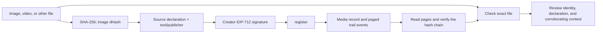

# ProvenanceX

**Register and verify the source of photos, videos, and files before sharing.** Compare a file with its registered original, inspect its signed source declaration, and follow its edit history. Declared AI/synthetic content is labeled separately from file integrity.

Bundled artwork is sample content. The public app supports general media and social sharing.

## Live demo and deployments

| Resource | Status |
| --- | --- |
| Live app | [provenancex.vercel.app](https://provenancex.vercel.app/) — public production site. |
| Repository | [github.com/utkarsh-wadalkar/ProvenanceX](https://github.com/utkarsh-wadalkar/ProvenanceX) — public source repository. |
| Monad Testnet contract (10143) | [`0xe33c5b4e0d9148bab301807d39bf2c0349037cce`](https://testnet.monadexplorer.com/address/0xe33c5b4e0d9148bab301807d39bf2c0349037cce), deployed at block `69776667`; deployment tx [`0x7909c5b4890c0ba88a03f63219e5b1478d790c71793229a9e3dced386730adba`](https://testnet.monadexplorer.com/tx/0x7909c5b4890c0ba88a03f63219e5b1478d790c71793229a9e3dced386730adba). |
| Testnet source verification | [Sourcify exact match, chain 10143](https://sourcify-api-monad.blockvision.org/v2/contract/10143/0xe33c5b4e0d9148bab301807d39bf2c0349037cce). |
| Monad Mainnet contract (143) | Not deployed. Mainnet requires a separately funded key and operator decision. |
| Custom domain | Pending the domain the team selects and controls. |
| Demo / ad videos | TODO: add the published demo and creative ad video links. |
| Social posts | TODO: add the published X and LinkedIn links. Draft copy is in [docs/posts.md](docs/posts.md); the team handles publishing. |
| Demo registration | Media record [`0x6c27ab45a494b45be78b79f5a173ea55c54040818d75420dbee2b8e01a768d6e`](https://provenancex.vercel.app/p/0x6c27ab45a494b45be78b79f5a173ea55c54040818d75420dbee2b8e01a768d6e), registration tx [`0xaa5c6aa579dcabfde0c73e92da53cd628e338ba7d9b61c72fd461d98a99cf250`](https://testnet.monadexplorer.com/tx/0xaa5c6aa579dcabfde0c73e92da53cd628e338ba7d9b61c72fd461d98a99cf250), block `69781769`. Signed tool: `[synthetic] Procedural demo artwork`; content hash `0x557bbb9f94db9c01266f7fd8a8d6158e472fc670399b830cf06ad4a4627c1686`. |
| Demo append | Creator append tx [`0x67ea0b93fd4247372e8024e23bbd0b93fed1b81a7ae8f1bd80d0277ee6767c75`](https://testnet.monadexplorer.com/tx/0x67ea0b93fd4247372e8024e23bbd0b93fed1b81a7ae8f1bd80d0277ee6767c75), block `69785004`. |

Monad Testnet uses chain ID `10143`, RPC `https://testnet-rpc.monad.xyz`, currency MON, and [Monad Explorer](https://testnet.monadexplorer.com/). Testnet MON is available from the [Monad Faucet](https://faucet.monad.xyz/). Confirm current network settings against [Monad's documentation](https://docs.monad.xyz).

The general-media production build is live at the URL above (revision `48711c6`). A further copy update replaces the frontend's media record terminology with media registration and verification language; that update awaits source publication.

## 1. Problem and solution

Photos, videos, and AI-generated media spread through social feeds, chats, and reposts with little source context. ProvenanceX lets everyday users check a downloaded file and lets creators register their original media. It compares the exact fingerprint with a public registry, displays the signer’s captured, synthetic, edited, or unknown declaration, and shows edit history and linked derivatives. Image similarity can suggest a related media record when bytes change. Download media from a post or upload the original file; the app does not ingest social post URLs or classify unregistered media with an AI detector. Review source identity and context before sharing.

## 2. How it works

The browser computes SHA-256 for the file and an image-only dHash for possible similarity lookup. The creator signs the content hash, a declared source tag and tool/publisher name together using EIP-712; that declaration is packed into the existing `tool` string and is limited to 64 UTF-8 bytes. The contract stores the media record and later audit events. A verifier reads bounded pages, checks the hash chain, and compares the exact file hash first. Any configured publisher allowlist is a deployment setting and review signal, not proof that the media depicts a real event.



The source declaration is one of `[captured]`, `[synthetic]`, `[edited]`, or `[unknown]`. Legacy unprefixed records parse as unknown. The registering wallet signs the declaration; no model or detector classifies the media. An empty trusted-publisher list trusts nobody. A trusted match means only that the registering address appears in the configured list. Exact file integrity, signer identity, source declaration, and content truth are separate questions.

### Architecture and contract API

| Component / function | Who can call | Purpose |
| --- | --- | --- |
| Browser hashing and `prepareAsset()` | Anyone using the app | Canonical SHA-256 for exact identity and dHash for image similarity. Videos and other non-image files get exact hashing only. |
| `register(contentHash, perceptualHash, tool, metadataURI, parentId, sig)` | Any caller presenting a valid signature from the registering wallet | Register a file claim and optional parent. The declaration and tool name are signed in the `tool` value. |
| `verifyByHash(contentHash)` / `passportIdByContentHash(contentHash)` | Anyone | Look up an exact registered file hash. |
| `getPassport(passportId)` / `getChildren(passportId)` | Anyone | Read media record fields and direct derivatives. |
| `totalPassports()` / `getPage(offset, limit)` | Anyone | Read registry size and pages, capped at 200. |
| `trailLength(passportId)` / `getTrailPage(passportId, offset, limit)` | Anyone | Read the stored audit trail in pages capped at 200. |
| `appendEvent(passportId, eventType, dataHash)` | Creator or authorized operator | Append a signed-wallet-origin event to the history. |
| `authorize(passportId, operator, allowed)` | Media record creator | Grant or remove append permission. |
| `revoke(passportId)` | Media record creator | Revoke the media record and prevent later trail appends. |
| `GET /api/verify?hash=0x…` | Public, read-only | Return exact-hash registry and declaration policy fields; it is not an content-truth verification service or SLA-backed API. |

The contract is [ContentPassport.sol](contracts/src/ContentPassport.sol), built with Solidity 0.8.28, Prague EVM settings, OpenZeppelin EIP-712 and ECDSA. The web app contains the Create, Verify, Media record, and guided Demo pages. The source declaration is stored as a signed `tool` string to preserve the deployed contract and ABI.

## 3. Verification outcomes and limits

| App result | Meaning |
| --- | --- |
| Exact file match / integrity verified | The uploaded canonical file hash matches a registered media record. It says nothing by itself about source, author, or content truth. |
| Declared captured media | The signer selected `[captured]`; unless its address is configured as a trusted publisher, treat this as self-declared. Even an allowlisted publisher requires independent context checks. |
| Declared synthetic media | The signer selected `[synthetic]`; no AI detector ran. |
| Modified / re-encoded candidate | An image dHash is within the matching threshold of a media record. The candidate's declaration belongs to that media record, not necessarily the uploaded copy. |
| Revoked / no media record / source unknown | These are distinct states. A registry or RPC failure is shown as an error, not as no match. |

For PNG, canonical SHA-256 excludes only a CRC-valid ProvenanceX metadata chunk, so embedding the media record does not change exact identity. Other PNG metadata remains hashed. Non-PNG images are converted to PNG before registration. Other file types are hashed as submitted. dHash is a non-cryptographic image similarity heuristic; crops, recompression, edits, and lookalike images can cause misses or false candidates. A zero dHash is excluded from similarity search, including uniform images that can legitimately produce zero; exact hash verification still works.

## 4. Run it yourself

### Prerequisites and clean setup

- Git, Node.js 20 or newer, npm, and a browser wallet for wallet-driven writes.
- Forge 1.7.1 is pinned through the portable npm package; OpenZeppelin Contracts 5.4.0 is pinned. Monad's current documentation recommends Forge 1.8 or newer for deployment; this project uses 1.7.1 for reproducible local checks, so follow Monad's current deployment guidance before publishing a new contract.
- Public repository: `https://github.com/utkarsh-wadalkar/ProvenanceX`.

```sh
git clone https://github.com/utkarsh-wadalkar/ProvenanceX.git provenancex
cd provenancex
npm ci --ignore-scripts
npm run install:contracts
npm --prefix web ci
```

The root Foundry package has an upstream POSIX-only postinstall that fails under Windows `cmd`; `npm ci --ignore-scripts` installs its optional platform binary, which runs without that script. The contracts install command installs OpenZeppelin. `web/package-lock.json` pins the app dependencies.

### Environment and network

Copy `.env.example` to `contracts/.env`. It documents the deployer's local-only `PRIVATE_KEY`, `CHAIN_ID`, RPC override variables, and the optional frontend settings. To override frontend settings, copy `web/.env.example` to `web/.env.local`. `NEXT_PUBLIC_RPC_URL` selects the browser RPC; `NEXT_PUBLIC_SITE_URL` sets the public origin; `NEXT_PUBLIC_GITHUB_URL` controls the source link; and `NEXT_PUBLIC_TRUSTED_PUBLISHERS` is a comma-separated list of publisher wallet addresses configured by the deployer. The optional `NEXT_PUBLIC_DEMO_KEY` is public to every visitor and must only be a disposable, low-balance Testnet key. Never put a deployment key there.

| Testnet setting | Value |
| --- | --- |
| Network / chain ID | Monad Testnet / `10143` (`0x279f`) |
| RPC | `https://testnet-rpc.monad.xyz` |
| Explorer | [testnet.monadexplorer.com](https://testnet.monadexplorer.com/) |
| Faucet | [faucet.monad.xyz](https://faucet.monad.xyz/) |

### Contract checks

```sh
npm run build
npm test
npm run test:exporter
```

### Optional local-chain integration

In a second terminal, start local Anvil on the expected chain, then run the integration command from the repository root:

```sh
npm exec --yes --package=@foundry-rs/anvil@1.7.1 -- anvil --host 127.0.0.1 --port 8545 --chain-id 10143
npm run integration:local
```

The integration generates ephemeral in-memory accounts, funds them through Anvil, deploys the compiled contract, registers an EIP-712 claim, checks duplicate rejection, reads the stored trail through the web ABI, verifies the hash chain, exercises creator/operator appends, and checks revocation. Fixture details go to ignored task scratch. Anvil results are local development evidence only, never Testnet or Mainnet deployment evidence.

### Web app checks and use

```sh
cd web
npm test
npm run typecheck
npm run lint
npm run build
npm run dev
```

Open `http://localhost:3000`. Connect a wallet on Monad Testnet to submit a real registration. In Create, choose the source declaration and tool/publisher name before signing. In Verify, upload the exact file; review the hash result, declaration, signer and allowlist signal. Open the media record for its event history. For a perceptual candidate, remember that the candidate's declaration does not automatically apply to the changed upload. Review the original creator, source, and context before reposting or relying on a claim.

The current UI manifest is configured for Monad Testnet at the contract address above. Testnet writes cost test MON but the contract currently charges no registration fee.

### Deploy and export

Use a separate low-balance deployment account. Keep its key only in `contracts/.env`. For Testnet, set `CHAIN_ID=10143` and use Foundry's `monad` RPC alias from the repository root:

```sh
npm exec -- forge script contracts/script/Deploy.s.sol:Deploy --root contracts --rpc-url monad --broadcast
npm run export:deployment
```

The exporter verifies the selected RPC reports the requested chain ID, then requires a successful ContentPassport receipt and mined block number. With no `CHAIN_ID`, it defaults to Testnet and writes `web/src/lib/deployment.json` plus the generated ABI. The committed canonical Testnet manifest is already configured to the deployed contract above. Source verification is separate; claim it only after the explorer or Sourcify confirms an exact match.

### Optional Mainnet 143 export

No Mainnet deployment exists. A future operator must use a separate funded key and Mainnet RPC. Set `CHAIN_ID=143` and `MAINNET_RPC_URL` in the operator shell, deploy with `--rpc-url "$MAINNET_RPC_URL"`, then run `npm run export:deployment`. In PowerShell set `$env:CHAIN_ID='143'` and `$env:MAINNET_RPC_URL='https://<official-mainnet-rpc>'` before those commands. The exporter validates chain ID 143 and writes `web/src/lib/deployment.mainnet.json`; it does not overwrite the Testnet manifest. The current web UI still targets Testnet. Verify Mainnet source with the appropriate official flow before publishing any address.

### Production URL and custom domain

Set the actual deployment URL in the project environment as `NEXT_PUBLIC_SITE_URL` and `NEXT_PUBLIC_GITHUB_URL` only after each is known and checked. Attach the team-selected domain to the existing Vercel project, add the DNS records Vercel shows, wait for domain verification, and check HTTPS routing before listing it here. The domain is pending team selection; no purchase or DNS change is claimed.

## 5. Product scenario, roadmap, and business model

An illustrative scenario, not a reported case study: someone receives a striking video in a group chat and wants to repost it. They download the file, compare its fingerprint with the registry, inspect the signed source declaration, and review its creator and context before sharing. For edited images, dHash may suggest a related media record; that candidate does not prove the uploaded copy's origin or that its content is true.

Customer discovery should start with everyday social-media users, independent creators, community moderators, fact-checkers, and publishers. Test whether checking downloaded media and registering originals fits their sharing workflow. Measure completion, understanding of signer declarations, repeat use, and demand for integrations. No adoption, customer, or misinformation-reduction results are claimed.

Potential revenue is a per-asset managed service, a bulk verification API, or an embeddable widget for creator, publishing, and moderation platforms. The deployed contract has no fee, and the current endpoint has no SLA. These are proposals to validate with teams, not shipped services.

Roadmap: test registration and sharing workflows with everyday users, creators, and moderators; improve source declaration and trusted-publisher administration; evaluate ingestion of external source attestations; and consider a separate Mainnet deployment only after pilot demand, trust governance, security, and costs are understood. See [docs/pitch.md](docs/pitch.md) for measurable hypotheses and [docs/demo-checklist.md](docs/demo-checklist.md) for rehearsal steps.

## 6. Submission links, team, and license

See [docs/submission.md](docs/submission.md) for the handoff checklist and [docs/posts.md](docs/posts.md) for ready-to-paste X/LinkedIn copy, a thread, and video scripts. Update only with real URLs, transactions, and view-count evidence. Social publishing is the team's task.

Team: TODO: add confirmed names and roles. The project is MIT licensed; see [LICENSE](LICENSE).
